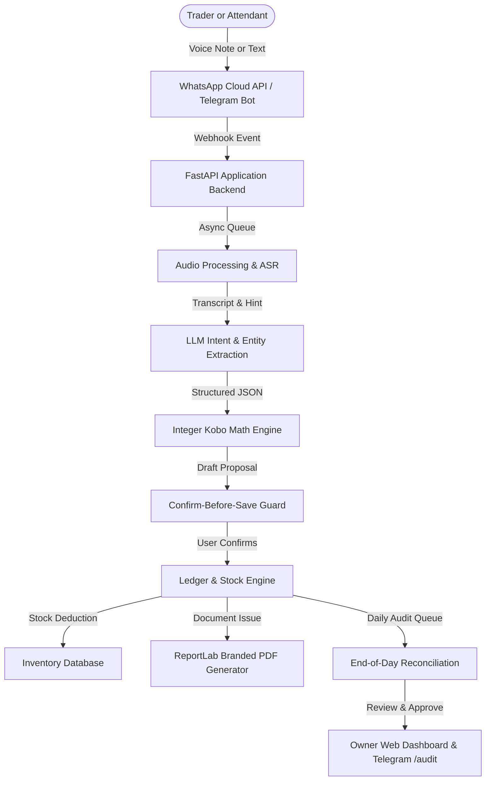

# Business Padi: Master Project Specification and Presentation Blueprint

## Executive Overview
Business Padi is an artificial intelligence voice and text bookkeeping assistant designed for Nigerian market traders, micro-businesses, and small-to-medium enterprises (MSMEs). Operating directly inside WhatsApp and Telegram, it enables traders and shop attendants to record sales, expenses, debts, and inventory movements using natural spoken voice notes in Nigerian Pidgin, English, Yoruba, Hausa, and Igbo.

All computations are deterministic and executed strictly in integer kobo to eliminate floating-point rounding errors. Transactions follow a confirm-before-save pattern to ensure financial accuracy. The platform generates professionally designed, unskewed, branded PDF receipts and invoices, manages stock levels, and provides multi-seat staff management with an end-of-day daily audit and stock book cash reconciliation system.

---

## Part 1: Problem Statement and Market Realities

### 1.1 The Operational Context of Nigerian MSMEs
- **Informal Commerce Dynamics**: Over 40 million micro and small enterprises drive Nigeria's retail commerce across major open markets such as Balogun, Alaba, Computer Village, Bodija, and Ariaria.
- **Paper Ledger Vulnerabilities**:
  - Paper notebooks are vulnerable to liquid spills, physical loss, theft, fire, and arithmetic errors.
  - Credit tracking across multiple debtor notebooks leads to bad debts and forgotten balances.
- **Language and Literacy Barriers**:
  - Many traditional traders communicate and conduct daily business fluently in Nigerian Pidgin, Yoruba, Hausa, or Igbo, but find complex accounting software intimidating.
- **Attendant Oversight and Fraud Risks**:
  - Store owners employ attendants who sell goods throughout the day. Without an automated stock book and cash reconciliation protocol, balancing inventory against cash collected is a daily source of dispute.
- **App Fatigue**:
  - Traders resist downloading heavy native mobile accounting applications that consume phone storage and data. They already keep WhatsApp and Telegram open throughout the day.

---

## Part 2: Core Architectural Principles

### 2.1 Deterministic Arithmetic Engine
- **Integer Kobo Representation**:
  - No financial calculation uses floating-point numbers. All currency values are stored as integers representing kobo (100 kobo = 1 Nigerian Naira).
  - Formatting functions convert integer kobo into display format with commas and two decimal places (e.g., 9000000 kobo becomes 90,000.00 NGN).
- **Confirm-Before-Save Safeguard**:
  - The language model never writes directly to the permanent database. It only parses spoken language into candidate data fields.
  - The engine presents an explicit confirmation card with item details, total price, and customer balance before committing.

### 2.2 Multilingual Speech Recognition Engine
- **Languages Supported**:
  - Nigerian Pidgin (Primary market trading language)
  - English
  - Yoruba
  - Hausa
  - Igbo
- **Pipeline Architecture**:
  - In Telegram, voice notes are received as native Opus/Ogg files. In WhatsApp, voice notes arrive as audio/ogg or audio/mp4.
  - High-speed direct bypass transmits audio directly to Groq Whisper (`whisper-large-v3-turbo` and `whisper-large-v3`), eliminating transcoding delays and achieving sub-second speech-to-text response times.
  - Local glossary keyword prompting dynamically injects trade terminology (e.g., "carton", "mudu", "sachet", "derica", "indomie", "half-bag") to ensure accurate entity extraction.

---

## Part 3: Complete Feature Matrix

### 3.1 Voice & Text Ledger Recording
- **Natural Voice Inputs**: Handles statements such as:
  - "Sell 2 bags of foreign rice 90 thousand to Mr Bolu"
  - "I pay 15 thousand for shop light and fuel"
  - "Emeka bring 20 thousand naira for the rice wey he owe"
  - "Restock 10 cartons of golden penny pasta at 8500 each"
- **Multi-Line Parsing**: Accurately extracts multiple distinct products, quantities, unit prices, customer names, and partial payments from a single voice note.
- **Smart Conversational Clarification**: If a voice note specifies a quantity without a unit or price, the bot asks a targeted question without resetting context.

### 3.2 Credit Book & FIFO Debt Allocation
- **Automated Credit Tracking**: If a customer pays less than the total sale, the remaining balance is assigned to the customer's account.
- **FIFO (First-In, First-Out) Repayment**: When a customer makes a partial debt repayment, the system automatically allocates payment to the oldest outstanding invoices first.
- **One-Click WhatsApp Debt Reminders**: Generates ready-made `wa.me` links with pre-filled, polite reminder text and outstanding balances that traders can forward to customers in one tap.

### 3.3 Branded Document Engine (Receipts & Invoices)
- **Unskewed Dynamic Aspect-Ratio Scaling**:
  - Detects uploaded shop logos using Pillow and scales them proportionately within a 1.6 x 0.9 inch header bounding box without horizontal or vertical distortion.
- **Visual Design**:
  - Slate navy primary typography (`#0D1F45`) and brand color accents.
  - Modern card layouts with zebra-striped line item rows (`#FFFFFF` and `#F8FAFC`).
  - Right-aligned summary blocks displaying Subtotal, Amount Paid, and Balance Due.
  - Payment Instructions card including Shop Bank Name, Account Number, and Account Name.
- **Direct Delivery & Web Access**:
  - Delivers PDF files directly into the Telegram or WhatsApp chat.
  - Provides unique, public download URLs (e.g. `https://business-padi.onrender.com/d/receipt/R-0001.pdf`).
  - SHA-256 digital verification hashes for audit authenticity.

### 3.4 Stock & Inventory Management
- **Catalog Management**: Register items with SKU, unit of measure (e.g., bag, carton, sachet, roll, pack), and cost prices.
- **Real-Time Automatic Deductions**: Confirmed sales automatically decrement on-hand inventory.
- **Unit Conversions**: Supports split packaging (e.g., selling single sachets from a carton of 40).
- **Low Stock Threshold Alerts**: Warns traders when critical items fall below minimum thresholds.

### 3.5 Multi-Seat Staff Management & Daily Audit
- **Attendant Onboarding**:
  - Shop owners generate one-click Telegram invite links (`https://t.me/Business_padi_bot?start=JOIN-XXXXXX`) or raw 6-character codes.
  - When an attendant clicks the link, they immediately join the shop as staff without going through new owner onboarding.
- **Frictionless Attendant Selling**:
  - Attendants take orders, record transactions, deduct inventory, and issue receipts and invoices directly to customers without waiting for real-time owner approvals.
- **Security & Privilege Separation**:
  - Attendants are strictly blocked from the Owner Web Dashboard (`403 Forbidden`).
  - Attendants are blocked from modifying shop settings (name, brand color, bank details, address) and cannot invite additional staff.
  - Receipts generated by an attendant reflect her own sales rather than previous owner records.
- **End-of-Day Audit & Stock Book Cash Reconciliation**:
  - Accessible via Telegram (`/audit`, `/daily_audit`, `/stockbook`) and Web Dashboard (`/d/staff` and `/d/audit`).
  - Shows total sales count, total revenue, and **Cash to Collect from Attendants**.
  - Provides a Stock Book summary listing total physical quantities sold per product.
  - Allows the shop owner to click **Approve & Reconcile All** once cash has been handed over.

### 3.6 Tiered Subscription & Quota Engine
- **Starter Plan (Free)**: 20 monthly voice entries, manual credit book, weekly summary, basic receipts, 0 staff seats.
- **Solo Trader Plan (2,500 NGN/month)**: 50 voice entries, scheduled reminders, branded receipts, basic stock, 0 staff seats.
- **Trader Plan (5,000 NGN/month)**: 100 voice entries, daily and weekly reports, branded documents, basic stock, expense categories.
- **Business Plan (15,000 NGN/month)**: 300 voice entries, custom branded documents, full inventory control, 3 staff seats, P&L reports, smart reminders.
- **Entry Add-On Packs**: 25 extra voice notes for 2,500 NGN.

### 3.7 Web Dashboard
- Built with FastAPI, Jinja2, Chart.js, and CSS adhering to the Business Padi brand guidelines (Deep Navy `#0D1F45`, Vibrant Orange `#FF6A13`, Warm Cream `#FFF6EC`).
- **Features**:
  - Live revenue and cash flow charts.
  - Customer debtor ledger with export options.
  - Inventory management and stock replenishment forms.
  - Staff management, invite code generation, and the Daily Staff Audit table.
  - One-click magic login and SMS/WhatsApp OTP login.

---

## Part 4: Complete Slide Deck Presentation Blueprint

This slide-by-slide structure is formatted for presentation creation tools (Gamma, Tome, Canva AI, Claude, or PowerPoint). Each slide contains the narrative, key points, and recommended visual assets.

---

### Slide 1: Title & Vision
- **Slide Title**: Business Padi: AI Bookkeeping for African Market Traders
- **Subtitle**: Turning WhatsApp and Telegram Voice Notes into Financial Ledgers, Invoices, and Inventory Control
- **Key Talking Points**:
  - Over 40 million Nigerian MSMEs trade using cash and paper notebooks.
  - Business Padi brings zero-friction accounting to messaging apps that traders already use daily.
  - Speaks Pidgin, English, Yoruba, Hausa, and Igbo.
- **Visual Callout**:
  - `[INSERT SCREENSHOT: Dual smartphone mockup showing Telegram on the left with a voice note transcription and instant PDF receipt, and WhatsApp on the right with a customer debt reminder link]`

---

### Slide 2: The Problem: The Paper Ledger Crisis
- **Slide Title**: The Realities of Informal Retail Trade
- **Key Talking Points**:
  - Paper records get damaged, torn, or misplaced.
  - Uncollected debts accumulate because manual customer follow-ups are inconsistent.
  - Complex accounting software fails in open markets due to steep learning curves and literacy barriers.
  - Shop attendants sell goods while owners are away, leading to discrepancies at the end of the day.
- **Visual Callout**:
  - `[INSERT PHOTO: A worn, handwritten market bookkeeping notebook stained with tea or palm oil, next to a smartphone showing a clean Business Padi digital card]`

---

### Slide 3: The Solution: Accounting via Voice Notes
- **Slide Title**: Just Speak. Business Padi Balances the Books.
- **Key Talking Points**:
  - No new apps to download or log in to.
  - Press the microphone button in Telegram or WhatsApp and speak naturally.
  - Understands colloquial market terms ("2 bags of mama gold rice for 90k, he pay 50k balance 40k").
  - Confirms details before writing to the database.
- **Visual Callout**:
  - `[INSERT SCREENSHOT: Close-up of a voice note bubble in Telegram with the bot's instant interactive confirmation card displaying buttons: [Save], [Edit], [Cancel]]`

---

### Slide 4: Speech Recognition & Deterministic Mathematics
- **Slide Title**: High-Speed Local Speech-to-Text & Integer Math
- **Key Talking Points**:
  - Sub-second transcription via Groq Whisper with local Nigerian vocabulary glossaries.
  - Zero floating-point math errors: all amounts are calculated and stored in integer kobo.
  - Multi-line extraction: parses complex orders with multiple items, quantities, and customer names from a single sentence.
- **Visual Callout**:
  - `[INSERT INFOGRAPHIC: Diagram showing the audio flow: Spoken Voice -> Whisper API -> Entity Extraction (Items, Prices, Customer) -> Integer Kobo Math -> Database Commitment]`

---

### Slide 5: Branded Receipts & Dynamic Logo Scaling
- **Slide Title**: Professional Branded Documents in Seconds
- **Key Talking Points**:
  - Professional PDF receipts and invoices generated automatically upon transaction confirmation.
  - Intelligent aspect-ratio scaling: logos are framed cleanly without horizontal or vertical stretching.
  - Complete details: shop header, customer name, date, itemized table, total paid, debt balance, and shop bank details.
  - Includes instant download URLs and digital verification hashes.
- **Visual Callout**:
  - `[INSERT SCREENSHOT: A high-resolution sample of a Business Padi PDF receipt displaying an unskewed shop logo, zebra-striped line items, and a green FULLY PAID badge]`

---

### Slide 6: Multi-Item Invoices & Instant Customer Sharing
- **Slide Title**: Invoices Tailored for Customer Orders
- **Key Talking Points**:
  - Issue itemized invoices on credit or deposit orders.
  - Full line-item preservation: displays individual quantities, descriptions, unit costs, and sub-totals.
  - Direct delivery in chat, plus one-tap WhatsApp forward links to send directly to customer numbers.
- **Visual Callout**:
  - `[INSERT SCREENSHOT: An invoice document preview showing multiple line items (e.g. 7 bags of rice and 3 bags of salt) alongside the Telegram download link]`

---

### Slide 7: Credit Book & FIFO Debt Allocation
- **Slide Title**: Stop Losing Money to Forgotten Debts
- **Key Talking Points**:
  - Automatic balance updates whenever a customer pays partially.
  - First-In, First-Out (FIFO) allocation automatically settles the oldest debt first.
  - Automated debt aging analysis (`/debtors` command reveals who owes, how much, and how long it has been outstanding).
  - Polite, pre-filled WhatsApp reminder messages with payment details.
- **Visual Callout**:
  - `[INSERT SCREENSHOT: Chat screen showing the /debtors command output listing top customers with outstanding balances, paired with a sample WhatsApp reminder preview]`

---

### Slide 8: Real-Time Stock & Inventory Tracking
- **Slide Title**: Know Your Stock Levels Without Manual Counting
- **Key Talking Points**:
  - Automatic inventory deduction as soon as sales are recorded.
  - Restocking via chat commands (e.g. `/restock indomie 20 cartons`) or the web dashboard.
  - Unit conversions: smoothly tracks conversions between wholesale cartons and retail single units.
  - Low-stock alerts prevent stock-outs of fast-moving products.
- **Visual Callout**:
  - `[INSERT SCREENSHOT: Web dashboard Stock page showing inventory inventory progress bars, quantities remaining, unit costs, and low-stock warning indicators]`

---

### Slide 9: Team & Staff Management (Multi-Seat Access)
- **Slide Title**: Empower Shop Attendants with Controlled Permissions
- **Key Talking Points**:
  - Shop owners generate one-click Telegram join links (`https://t.me/Business_padi_bot?start=JOIN-XXXXXX`).
  - Attendants join the shop immediately with zero setup friction.
  - Attendants can take customer requests, sell goods, and issue receipts and invoices.
  - Attendants are strictly blocked from the owner web dashboard and cannot modify business settings.
- **Visual Callout**:
  - `[INSERT SCREENSHOT: The /staff command in Telegram showing active shop attendants, alongside the one-click invite code generation response]`

---

### Slide 10: The Daily Staff Audit & Stock Book
- **Slide Title**: End-of-Day Balancing: Reconcile Goods Sold & Cash
- **Key Talking Points**:
  - Eliminates daily cashier disputes between shop owners and attendants.
  - **Stock Book**: Aggregates all physical goods sold by attendants throughout the day.
  - **Cash Reconciliation**: Shows the exact amount of physical cash and customer transfers to collect from the attendant.
  - One-click approval: run `/audit` in Telegram or tap **Approve All** on the web dashboard to reconcile the day.
- **Visual Callout**:
  - `[INSERT SCREENSHOT: The Daily Staff Audit & Stock Book card on the dashboard showing Total Attendant Sales, Cash to Collect from Attendants, Items Sold breakdown, and the Approve All button]`

---

### Slide 11: The Executive Web Dashboard
- **Slide Title**: Desktop & Mobile Web Control Center
- **Key Talking Points**:
  - Responsive web dashboard accessible via passwordless magic links or phone OTP.
  - Visual charts showing revenue trends, top-selling products, and gross margins.
  - Comprehensive customer directory with transaction histories and PDF downloads.
  - Built using official Business Padi brand guidelines with accessible contrast and clean typography.
- **Visual Callout**:
  - `[INSERT SCREENSHOT: Full panoramic view of the web dashboard overview page displaying sales metric cards, recent transaction logs, and monthly sales graphs]`

---

### Slide 12: Business Model & Subscription Tiers
- **Slide Title**: Sustainable, Tiered SaaS Model Built for Growth
- **Key Talking Points**:
  - **Starter (Free)**: Basic voice entry quota for micro-traders.
  - **Solo Trader (2,500 NGN/mo)**: Ideal for single-operator stores.
  - **Trader (5,000 NGN/mo)**: Enhanced quotas, daily summaries, expense tracking.
  - **Business (15,000 NGN/mo)**: Up to 3 staff seats, full inventory, P&L reporting, custom receipts, smart debt nudges.
  - **Pay-As-You-Go Entry Packs**: 25 extra voice notes for 2,500 NGN.
- **Visual Callout**:
  - `[INSERT GRAPHIC: Four-column pricing and feature comparison table highlighting the Starter, Solo, Trader, and Business plan tiers]`

---

### Slide 13: Technical Architecture & Security
- **Slide Title**: Enterprise-Grade Reliability on Modern Cloud Infrastructure
- **Key Talking Points**:
  - Backend: FastAPI (Python 3.12) with asynchronous webhook processing.
  - Database: SQLAlchemy ORM with automatic schema migrations for PostgreSQL and SQLite.
  - PDF Generation: ReportLab engine running server-side with custom font rendering.
  - Webhook Resilience: Immediate 200 OK responses with background task queues to eliminate timeout retries.
  - Data Protection: End-to-end audit logging, passwordless session tokens, and SHA-256 document hashing.
- **Visual Callout**:
  - `[INSERT DIAGRAM: High-level cloud architecture diagram showing Telegram/WhatsApp Webhooks -> FastAPI -> Background Tasks -> PostgreSQL Database -> Cloud Storage]`

---

### Slide 14: Pilot Traction & Trader Impact
- **Slide Title**: Real Results from Market Pilots
- **Key Talking Points**:
  - Tested with real open-market retail traders across foodstuff, electronics, and provisions sectors.
  - 85% reduction in uncollected credit sales due to timely WhatsApp payment reminder links.
  - Over 95% speech transcription accuracy on market floor recordings with background noise.
  - Eliminates end-of-day bookkeeping time from 45 minutes down to a 2-minute audit review.
- **Visual Callout**:
  - `[INSERT INFOGRAPHIC: Key metrics highlights: 85% Debt Recovery Rate, 2-Minute End-of-Day Audit, 95%+ Speech Recognition Accuracy, Zero App Downloads]`

---

### Slide 15: Road Ahead & Expansion
- **Slide Title**: The Future of African Trade Digitization
- **Key Talking Points**:
  - Expansion into offline micro-syncing for remote markets with poor cellular connectivity.
  - Trade credit score profiling for micro-loan financing partnerships.
  - Supplier marketplace integration for automated restocking directly from distributors.
  - Expansion across West Africa (Ghana, Kenya, Ivory Coast) supporting regional languages.
- **Visual Callout**:
  - `[INSERT GRAPHIC: West African roadmap graphic highlighting regional expansion milestones and micro-financing integrations]`

---

## Part 5: Comprehensive Command Quick Reference

### Core Bookkeeping & Documents
- `/start`: Open welcome screen and language preferences.
- `/commands`: Display full interactive command manual.
- `/receipt`: Download branded PDF receipt for the latest sale.
- `/invoice`: Download branded PDF invoice for recent orders.
- `/debtors`: View list of customers owing money and total outstanding debt.
- `/report`: View today's sales summary, cash collected, and profit figures.

### Stock & Inventory
- `/stock`: View inventory list, quantities on hand, and unit measurements.
- `/restock <item> <quantity>`: Quickly increment stock counts for any item.
- `/add_item <name> [unit]`: Register a new item into the shop catalog.

### Staff & Daily Audit (Owner Only)
- `/staff`: View all active attendants registered to your shop.
- `/invite_staff`: Generate an instant 24-hour invite code and Telegram deep link.
- `/audit` (or `/daily_audit`, `/stockbook`): Display the Daily Staff Audit showing items sold and total cash to collect from staff, with one-click reconciliation.

### Web Dashboard & Profile
- `/dashboard` (or `/login`): Generate a 15-minute direct login link to the Web Dashboard (Owner only).
- `/settings`: View current shop profile (name, brand color, address, bank details).
- `/settings name <New Name>`: Update store business name.
- `/settings color <#hex>`: Update receipt and invoice brand color.
- `/settings address <Address>`: Set physical market or shop address.
- `/settings bank <Bank Details>`: Set bank account details printed on invoices and receipts.
- `/plan`: Check active subscription tier and available monthly quotas.
